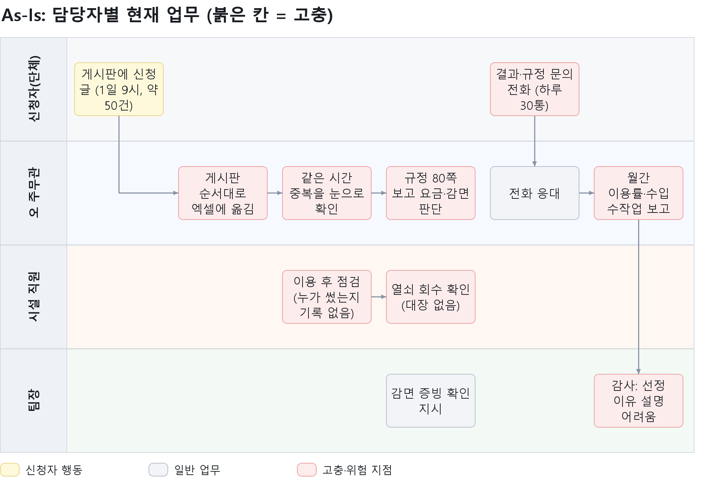
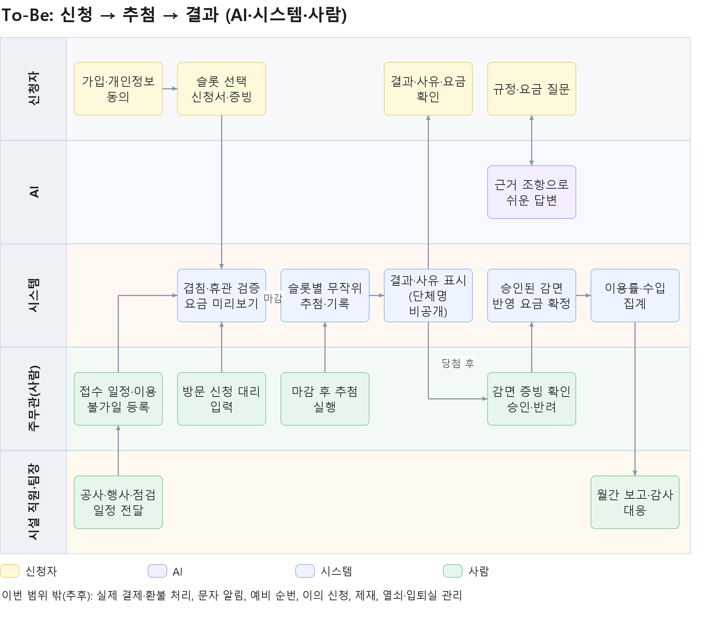
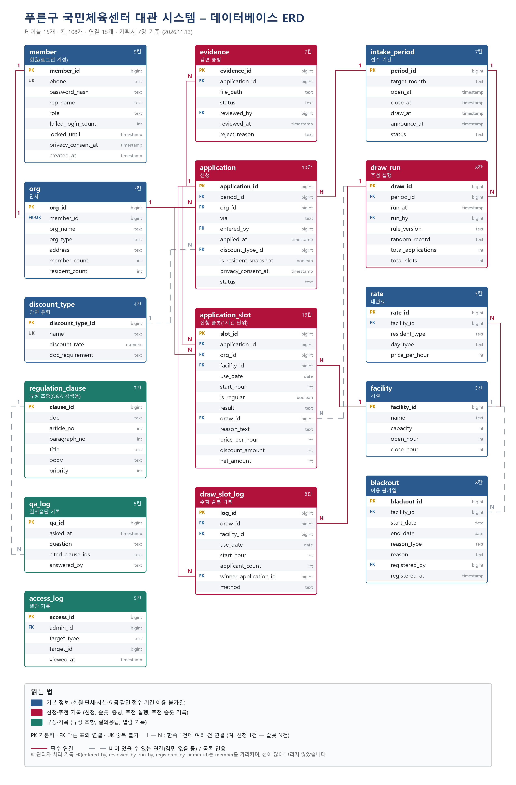

# 푸른구 국민체육센터 대관 시스템 기획서

가상 고객 인터뷰를 바탕으로 한 실습용 기획서 (초안) · 작성일 2026-11-13

문서 상태: 초안 / 근거 자료: 고객 소개, 인터뷰 기록 01·02, 요구사항 정의서, 가상 조례·운영 규정·대관료 표·6개월 대관 기록

## 목차

- [1. 고객과 배경](#1-고객과-배경)
- [2. 고객의 요청](#2-고객의-요청)
- [3. 진짜 문제](#3-진짜-문제)
- [4. To-Be](#4-to-be)
- [5. 사용자](#5-사용자)
- [6. 화면 목록](#6-화면-목록)
- [7. 데이터 설계](#7-데이터-설계)
- [8. 규칙](#8-규칙)
- [9. 백엔드 기능 목록](#9-백엔드-기능-목록)
- [10. 비용·운영 방법](#10-비용운영-방법)
- [11. 완료 기준](#11-완료-기준)
- [12. 필수 기능 대조표](#12-필수-기능-대조표)

## 1. 고객과 배경

### 1.1 고객

푸른구청이 운영하는 푸른구 국민체육센터입니다. 시간 단위로 시설을 단체에 빌려줍니다.

| 항목 | 내용 |
|---|---|
| 시설 | 실내체육관 1, 다목적실 2(A·B), 풋살장 1 |
| 인력 | 대관 담당 공무원 1명(오 주무관), 시설 관리 직원 2명, 팀장 1명 |
| 접수 방식 | 홈페이지 게시판과 방문 접수. 담당자가 엑셀 달력에 직접 입력 |
| 요금 기준 | 구 조례(상위)와 센터 운영 규정(세부). 두 문서를 합치면 약 80쪽 |
| 요금 구분 | 구민 단체와 비구민 단체의 요금이 다름 |
| 감면 | 장애인 단체, 국가유공자 단체, 구 소재 학교, 노인 단체. 증빙 서류 확인이 필요 |

### 1.2 배경: 매달 1일 오전 9시

다음 달 대관 신청이 열리는 매달 1일 오전 9시, 게시판에 글이 약 50개 올라옵니다. 오 주무관은 올라온 순서대로 엑셀에 옮기다가 같은 토요일 오전 풋살장에 세 팀이 신청한 것을 봅니다. 한 동호회는 "장애인 단체라 감면 대상 아닌가요?"라고 묻고, 다른 신청자는 "구민이 아닌데 신청해도 되나요?"라고 묻습니다. 오 주무관은 조례와 운영 규정 두 문서를 함께 펼칩니다.

### 1.3 숫자로 본 현재 상황

| 지표 | 값 | 출처 |
|---|---|---|
| 매달 1일 9시 신청 글 | 약 50건 | 고객 소개 |
| 규정 문의 전화 | 하루 약 30통 | 오 주무관 |
| 조례와 규정 분량 | 약 80쪽 | 오 주무관 |
| 감면 유형 | 4가지(감면율이 서로 다름) | 오 주무관 |

## 2. 고객의 요청

### 2.1 인터뷰에서 나온 말

| 말한 사람 | 한 말 | 우리가 읽은 요청 |
|---|---|---|
| 오 주무관 | 게시판 순서로 정하면 공정하지 않다는 민원이 온다 | 공정하게 선정하는 방법 |
| 오 주무관 | 감면 기준이 복잡하다 | 감면율과 증빙 규칙을 정리 |
| 팀장 | 감면은 증빙 서류를 확인해야 한다. 말로만 하면 안 된다 | 증빙 승인 후에만 감면 적용 |
| 오 주무관 | 조례와 규정이 있고 합치면 80쪽이다 | 규정을 쉽게 찾고 이해하게 |
| 시설 직원 | 시설이 망가져 있으면 누가 썼는지 알아야 한다 | 이용 이력 기록 |
| 팀장 | 한 단체가 좋은 시간을 다 가져가면 안 된다 | 정기 대관 상한 |
| 오 주무관 | 취소하면 환불이 시점마다 다르다 | 환불 기준 안내 |
| 시설 직원 | 공사나 행사로 못 쓰는 날은 신청을 막아야 한다 | 이용 불가일 차단 |
| 팀장 | 구민과 비구민의 요금이 다르다 | 요금 구분 계산 |
| 오 주무관 | 규정 문의 전화가 하루 30통이다 | 문의를 줄이는 안내 |
| 팀장 | 개인정보 처리 동의가 꼭 필요하다 | 동의 후 신청 |
| 오 주무관 | 달마다 시설별 이용률과 대관료 수입을 보고한다 | 이용률·수입 조회 |
| 시설 직원 | 열쇠를 안 돌려주는 단체가 있다 | 열쇠 관리(이번 제외) |
| 팀장 | 시설 안전 점검 날은 한 달 전에 정해진다 | 점검일 등록과 차단 |
| 오 주무관 | 신청 인원보다 훨씬 많이 오기도 한다 | 인원 차이 확인(추후) |
| 팀장 | 감사 때 왜 그 단체가 됐는지 보여줘야 한다 | 선정 과정 기록 |

### 2.2 2차 인터뷰에서 확정된 것

- 신청이 몰릴 때는 선착순이 아니라 **접수 마감 뒤 추첨**으로 정한다. 구민·감면 여부로 가산점을 주지 않는다.
- 신청자가 왜 선정됐는지 확인할 수 있어야 하고, 감사 때 기준과 과정을 보여줄 수 있어야 한다. 단체명 목록은 외부에 공개하지 않는다.
- **방문 신청도 같은 접수 기간, 같은 추첨에 포함**한다.
- 이번에는 실제 결제·환불 처리와 열쇠·입퇴실 관리가 없어도 된다.
- 감면은 여러 사유가 있어도 가장 높은 감면율 하나만 적용하고, 증빙은 담당자 확인 후 적용한다.
- 환불은 이용일 7일 전까지 전액, 3일 전까지 50%, 그 이후 없음이다. 센터 사정으로 취소되면 전액 환불한다.
- 목표는 공정성 민원을 "0건"으로 만드는 것이 아니라 줄이는 것이고, 규정 문의 전화도 줄이는 것이다.

### 2.3 필수 기능 7가지 (고객의 기본 요구)

| 번호 | 필수 기능 |
|---|---|
| B01 | 시설과 시간대별로 대관을 신청받고, 같은 시설 같은 시간에 확정된 대관이 겹치지 않는다 |
| B02 | 신청이 몰리는 시간은 공정한 방법으로 정한다 |
| B03 | 감면 대상은 증빙 서류를 올리고, 담당자가 확인해야 감면이 적용된다 |
| B04 | 신청자가 대관료·감면·취소 환불을 물으면 조례와 운영 규정을 근거로 답한다. 조례가 우선이고 근거 위치가 보인다 |
| B05 | 공사나 행사로 쓸 수 없는 날은 신청할 수 없다 |
| B06 | 시설별 이용률과 대관료 수입을 볼 수 있다 |
| B07 | 개인정보 처리 동의를 받아야 신청할 수 있다 |

## 3. 진짜 문제

### 3.1 고객이 말한 문제와 진짜 원인

| 겉으로 보이는 문제 | 진짜 문제 | 근거 |
|---|---|---|
| 공정성 민원이 온다 | 선정 기준이 "게시판 순서"뿐이고, 선정 과정이 기록으로 남지 않아 설명할 수 없다 | 오 주무관, 팀장(감사) |
| 전화가 하루 30통이다 | 요금·감면·환불 규칙이 80쪽 두 문서에 흩어져 있어 사람이 매번 찾아 답한다 | 오 주무관 |
| 같은 시간 세 팀이 신청되었다 | 엑셀 달력은 겹침과 이용 불가일을 막아주지 않아 사람의 눈에 의존한다 | 인터뷰 장면 |
| 감면 확인이 어렵다 | 증빙 확인과 요금 계산이 분리되어 있지 않고 감면율 4종·중복 규칙을 사람이 기억해야 한다 | 오 주무관, 팀장 |
| 시설이 망가져도 누가 썼는지 모른다 | 이용 이력(누가, 몇 시, 몇 명)이 기록되지 않는다 | 시설 직원 |
| 보고가 힘들다 | 이용률과 수입을 엑셀에서 손으로 집계한다 | 오 주무관 |

### 3.2 핵심 한 문장

> **규칙이 시스템이 아니라 사람의 머리와 문서에 있어서, 몰리는 신청과 문의를 사람이 한꺼번에 감당하고 그 결정의 근거도 남지 않는다.**

그래서 해결의 방향은 세 가지입니다.

1. 규칙(겹침, 이용 불가일, 요금, 감면율)은 시스템이 계산한다.
2. 판단이 필요한 일(증빙 확인, 방문 대리 입력, 추첨 시작)은 사람이 맡는다.
3. 규정을 읽고 설명하는 일은 AI가 근거 조항과 함께 돕는다.

### 3.3 As-Is: 담당자별 현재 업무 맵

그림을 누르면 큰 이미지로 열립니다. 원본(draw.io)은 [asis.drawio](기획서_다이어그램/asis.drawio)입니다.

[](기획서_다이어그램/asis.png)

| 담당자 | 지금 하는 일 | 고충 | 인터뷰 근거 |
|---|---|---|---|
| 신청자(단체) | 매달 1일 9시에 게시판에 글을 쓰고, 결과와 규정은 전화로 묻는다 | 결과를 모르고 규정 내용을 직접 찾기 어렵다 | 오 주무관: 전화가 하루 30통 |
| 오 주무관 | 올라온 순서대로 엑셀에 옮기고, 중복을 눈으로 확인하고, 조례·규정을 펼쳐 요금·감면을 판단하고, 전화를 받고, 월말에 이용률·수입을 보고한다 | 같은 시간에 세 팀이 신청되고 순서로 정해 민원이 온다. 80쪽 문서를 함께 펼친다 | 오 주무관 |
| 시설 직원 | 이용 후 점검을 하고 열쇠를 회수한다 | 누가 썼는지 기록이 없고 열쇠 대장이 없다 | 시설 직원 |
| 팀장 | 감면 증빙 확인을 지시하고 감사에 대응한다 | 감사 때 선정 이유를 보여줄 자료가 없다 | 팀장 |

### 3.4 이번에 풀 문제와 풀지 않을 문제

| 구분 | 문제 | 이번 대응 |
|---|---|---|
| 이번에 푼다 | 선정의 공정성과 과정 기록 | 슬롯별 무작위 추첨, 추첨 기록 보관, 선정 사유 안내 |
| 이번에 푼다 | 규정 문의 | 근거 조항을 보여주는 AI 질의응답 |
| 이번에 푼다 | 겹침·휴관일·요금·감면 계산 | 시스템 자동 검증과 계산 |
| 이번에 푼다 | 보고 | 이용률·수입 화면 조회 |
| 이번에 안 푼다 | 실제 결제·환불 처리, 문자 알림 | 추후 |
| 이번에 안 푼다 | 열쇠 대여·반납, 입퇴실 기록, 인원 차이 | 추후 (이용 이력은 신청·확정 기록으로 최소 조회) |

## 4. To-Be

### 4.1 원칙

**규칙은 시스템이, 판단은 사람이, 설명은 AI가 맡는다.** 추첨과 요금 계산처럼 결과가 정확하고 설명 가능해야 하는 일에는 AI를 쓰지 않습니다.

### 4.2 AI·시스템·사람이 할 일

| 구분 | 할 일 | 하지 않는 일 |
|---|---|---|
| **AI** | 신청자의 규정·요금·환불 질문에 대해, 검색된 조례·규정 조항만 근거로 쉬운 말로 답하고 조항 위치(문서·조·항)를 함께 보여준다. 근거가 없으면 "담당자에게 문의하세요"로 답한다 | 추첨, 요금·환불 금액 계산, 감면 승인, 개인정보 판단 |
| **시스템** | 접수 기간 적용, 겹침·이용 불가일 검증, 중복 신청 차단, 요금 미리보기와 확정 계산, 슬롯별 무작위 추첨과 과정 기록, 결과·선정 사유 표시, 이용률·수입 집계, 개인정보 동의 확인, 개인정보 가림 표시 | 증빙 서류의 진위 판단, 이의·제재 판단 |
| **사람** | 접수 일정·이용 불가일 등록(주무관, 시설 직원이 일정 전달), 방문 신청 대리 입력, 추첨 시작 버튼, 감면 증빙 확인·승인·반려, 월간 보고와 감사 대응(팀장) | 규칙 계산(시스템이 대신함) |

### 4.3 To-Be 흐름 (제안)

그림을 누르면 큰 이미지로 열립니다. 원본(draw.io)은 [tobe.drawio](기획서_다이어그램/tobe.drawio)입니다.

[](기획서_다이어그램/tobe.png)

| 단계 | 누가 | 무엇을 | 범위 |
|---|---|---|---|
| 1 | 주무관, 시설 직원 | 이용 가능한 달의 접수 일정(1일 9시~5일 18시)과 공사·행사·점검일을 등록한다 | 이번 |
| 2 | 신청자 | 가입하고 개인정보 처리에 동의한다 | 이번 |
| 3 | 신청자 | 시설·시간 현황에서 희망 슬롯을 고르고 단체 정보와 감면 증빙을 올려 신청한다 | 이번 |
| 4 | 시스템 | 겹침, 이용 불가일, 같은 단체 중복을 검증하고 요금을 미리 보여준다 | 이번 |
| 5 | 주무관 | 방문 신청을 접수 기간 안에 대신 입력한다. 같은 목록으로 합쳐진다 | 이번 |
| 6 | 주무관, 시스템 | 마감 후 추첨 시작 버튼을 누르면 시스템이 슬롯별로 무작위 추첨하고 과정을 기록한다 | 이번 |
| 7 | 시스템, 신청자 | 결과와 선정 사유를 보여준다. 탈락자에게는 남은 시간대 안내를 함께 보여준다 | 이번 |
| 8 | 주무관 | 당첨된 신청의 감면 증빙을 확인하고 승인·반려한다 | 이번 |
| 9 | 시스템, 신청자 | 승인된 감면을 반영해 요금을 확정하고 안내한다 | 이번 |
| 10 | 시스템, 팀장 | 월별 이용률과 대관료 수입을 집계해 보고하고, 감사에는 추첨 기록을 제시한다 | 이번 |
| 상시 | 신청자, AI | 규정·요금·환불을 물으면 근거 조항과 함께 답한다 | 이번 |
| 이후 | 시스템 | 결제 안내·환불 처리, 문자 알림, 예비 순번, 이의 신청, 제재, 열쇠·입퇴실 관리 | 추후 |

### 4.4 As-Is에서 달라지는 점

| 항목 | As-Is | To-Be |
|---|---|---|
| 선정 | 게시판 순서 | 슬롯별 무작위 추첨, 단독 신청은 자동 선정 |
| 설명 | 설명할 자료 없음 | 선정 사유 문구와 추첨 기록 |
| 겹침 확인 | 사람이 눈으로 | 시스템이 신청 시점에 차단 |
| 요금·감면 | 80쪽을 펴서 판단 | 시스템 계산, 증빙은 사람이 승인 |
| 규정 문의 | 전화 | 근거 조항을 보여주는 AI 질의응답 |
| 접수 | 게시판 + 방문, 엑셀 | 온라인 + 방문 대리 입력, 한 목록 |
| 보고 | 엑셀 수작업 | 화면 집계 |

## 5. 사용자

### 5.1 사용자 유형

| 사용자 | 설명 | 주로 쓰는 기기 | 이번 개발 |
|---|---|---|---|
| 신청자(단체 대표) | 5인 이상 단체의 대표자. 단체당 계정 1개. 구민·비구민 모두 가능 | **모바일과 PC 모두** | 사용 |
| 관리자 | 오 주무관, 시설 직원, 팀장의 업무를 한 역할로 묶음 | PC | 사용 |
| 시설 직원·팀장 분리 | 시설 직원은 이용 불가일·이용 이력, 팀장은 감사·제재 결재 | PC | 추후 |

> 신청자 화면은 모바일에서도 PC에서도 사용할 수 있어야 합니다(반응형). 관리자 화면은 PC 기준으로 만들고, 작은 화면에서도 깨지지 않게 보여줍니다(가정).

### 5.2 권한

| 기능 | 비로그인 | 신청자 | 관리자 |
|---|---|---|---|
| 접수 일정·시설 현황 조회 | O | O | O |
| 규정 Q&A | O | O | O |
| 회원가입·로그인 | O | - | - |
| 신청서 작성·내 신청 조회 | - | O(본인 것만) | - |
| 감면 증빙 업로드 | - | O(본인 것만) | - |
| 신청 목록 조회·방문 대리 입력 | - | - | O |
| 감면 증빙 열람·승인·반려 | - | - | O |
| 추첨 실행·추첨 기록 조회 | - | - | O |
| 이용 불가일 등록·접수 일정 설정 | - | - | O |
| 이용률·수입·이용 이력 조회 | - | - | O |

### 5.3 신청자의 요구 한눈에

- 언제 신청이 열리고 언제 결과가 나오는지 쉽게 보고 싶다.
- 내 단체가 구민 요금인지, 감면이 되는지, 요금이 얼마인지 미리 알고 싶다.
- 떨어졌을 때 왜 떨어졌는지, 남은 시간은 언제 신청하는지 알고 싶다.
- 전화하지 않고 규정을 물어보고 싶다.

## 6. 화면 목록

### 6.1 화면 구성 원칙

- **신청자 화면은 모바일(약 360px)과 PC(1024px 이상) 모두에서 같은 기능을 쓸 수 있게 반응형으로 만든다.** 모바일은 1열, PC는 2열 이상으로 배치한다.
- 모바일에서도 누르기 쉽도록 버튼은 높이 44px 이상으로 한다.
- 관리자 화면은 PC 기준(표 중심)으로 만든다.
- 개인정보(이름, 휴대전화)는 목록·화면에서 일부를 `*`로 가려 보여준다.

### 6.2 신청자 화면

| ID | 화면 | 주요 내용 | 모바일 / PC 차이 | 관련 필수 기능 |
|---|---|---|---|---|
| S-01 | 메인 | 이번 달 접수 일정(1일 9시~마감), 추첨·발표 일정, 신청·규정 질문 바로가기 | 모바일은 카드 1열, PC는 일정 + 바로가기 2열 | B02 |
| S-02 | 회원가입 | 개인정보 처리 동의, 대표자·단체 정보 입력, 휴대전화 인증(간이) | 모바일은 단계별 화면, PC는 한 화면 | B07 |
| S-03 | 로그인 | 휴대전화 번호·비밀번호 | 동일 | B07 |
| S-04 | 시설·시간 현황 | 시설별 달력, 이용 불가일 표시, 슬롯 선택 | 모바일은 시설 탭 + 날짜 목록, PC는 월 달력 | B01, B05 |
| S-05 | 신청서 | 희망 슬롯 목록, 단체 회원 수·구민 수, 감면 유형·증빙 업로드, 요금 미리보기, "일부만 당첨될 수 있음" 안내 | 모바일은 위에서 아래 순서, PC는 좌 입력·우 요금 요약 | B01, B03, B07 |
| S-06 | 내 신청·결과 | 접수 확인, 당첨/탈락, 선정 사유, 요금, 감면 확인 상태, 남은 시간대 안내 | 모바일은 카드, PC는 표 | B02, B03 |
| S-07 | 규정 안내(Q&A) | 질문 입력, 답변, 근거 조항 위치 표시, 환불 계산 | 모바일은 대화 형태, PC는 대화 + 근거 패널 | B04 |

### 6.3 관리자 화면

| ID | 화면 | 주요 내용 | 관련 필수 기능 |
|---|---|---|---|
| A-01 | 대시보드 | 접수 건수, 감면 확인 대기, 추첨 일정 | - |
| A-02 | 신청 관리 | 신청 목록(가림 표시), 방문 신청 대리 입력, 중복 확인 | B01, B02 |
| A-03 | 감면 증빙 검토 | 서류 보기, 승인·반려(사유) | B03 |
| A-04 | 추첨 관리 | 슬롯별 신청 건수, 추첨 실행 버튼, 결과 확정 | B02 |
| A-05 | 추첨 기록 | 추첨 시각, 건수, 규칙 버전, 슬롯별 결과(개인정보 가림) | B02 |
| A-06 | 이용 불가일 관리 | 공사·행사·점검일 등록, 기존 신청 영향 표시 | B05 |
| A-07 | 통계 | 월별·시설별 이용률, 대관료 수입 | B06 |
| A-08 | 이용 이력 | 누가 어느 시간에 썼는지 조회 | (추가) |

### 6.4 메뉴 구조

```
신청자
├─ 메인 (S-01)
├─ 시설·시간 현황 (S-04) → 신청서 (S-05)
├─ 내 신청·결과 (S-06)
├─ 규정 안내 Q&A (S-07)
└─ 회원가입 (S-02) / 로그인 (S-03)

관리자
├─ 대시보드 (A-01)
├─ 신청 관리 (A-02) ─ 감면 증빙 검토 (A-03)
├─ 추첨 관리 (A-04) ─ 추첨 기록 (A-05)
├─ 이용 불가일 관리 (A-06)
├─ 통계 (A-07)
└─ 이용 이력 (A-08)
```

## 7. 데이터 설계

### 7.1 ERD

테이블 15개를 색으로 구분했습니다. 파랑은 기본 정보, 빨강은 신청·추첨 기록, 초록은 규정·기록입니다. 그림을 누르면 큰 이미지로 열립니다.

[](기획서_다이어그램/erd.png)

### 7.2 테이블 목록

| 테이블 | 한글명 | 역할 |
|---|---|---|
| member | 회원 | 신청자·관리자 계정 |
| org | 단체 | 신청 단위인 단체 정보 |
| facility | 시설 | 시설과 수용 인원, 운영 시간 |
| rate | 대관료 | 시설·구민 구분·요일 구분별 시간당 요금 |
| discount_type | 감면 유형 | 감면율과 증빙 요건 |
| intake_period | 접수 기간 | 월별 접수·추첨·발표 일정 |
| blackout | 이용 불가일 | 공사·행사·점검·휴관 |
| application | 신청 | 단체의 한 번의 신청 |
| application_slot | 신청 슬롯 | 신청에 포함된 1시간 단위 슬롯과 결과·요금 |
| evidence | 감면 증빙 | 업로드된 증빙과 검토 결과 |
| draw_run | 추첨 실행 | 추첨 1회의 기록 |
| draw_slot_log | 추첨 슬롯 기록 | 슬롯별 신청 건수와 당첨 결과 |
| regulation_clause | 규정 조항 | 조례·규정 조항 원문(Q&A 검색 대상) |
| qa_log | 질의응답 기록 | 질문과 인용 조항(개인정보 제외) |
| access_log | 열람 기록 | 관리자의 개인정보 상세 열람 |

### 7.3 테이블별 칸

**member (회원)**

| 칸 | 형식 | 키 | 설명 |
|---|---|---|---|
| member_id | 정수 | PK | 회원 번호 |
| phone | 문자 | UNIQUE | 휴대전화(로그인 아이디) |
| password_hash | 문자 | | 비밀번호 암호화 값(원문 저장 안 함) |
| rep_name | 문자 | | 대표자 성명 |
| role | 문자 | | applicant(신청자) / admin(관리자) |
| failed_login_count | 정수 | | 연속 로그인 실패 횟수 |
| locked_until | 일시 | | 잠금 해제 시각 |
| privacy_consent_at | 일시 | | 개인정보 처리 동의 시각 |
| created_at | 일시 | | 가입 일시 |

**org (단체)**

| 칸 | 형식 | 키 | 설명 |
|---|---|---|---|
| org_id | 정수 | PK | 단체 번호 |
| member_id | 정수 | FK, UNIQUE | 대표자(단체당 계정 1개) |
| org_name | 문자 | | 단체명 |
| org_type | 문자 | | 일반 동호회 / 장애인 단체 / 국가유공자 단체 / 구 소재 학교 / 노인 단체 |
| address | 문자 | | 단체 주소 |
| member_count | 정수 | | 회원 수(5인 이상) |
| resident_count | 정수 | | 푸른구민 회원 수 |

**facility (시설)**

| 칸 | 형식 | 키 | 설명 |
|---|---|---|---|
| facility_id | 정수 | PK | 시설 번호 |
| name | 문자 | | 실내체육관 / 다목적실A / 다목적실B / 풋살장 |
| capacity | 정수 | | 수용 인원 |
| open_hour | 정수 | | 운영 시작 시각(9) |
| close_hour | 정수 | | 운영 종료 시각(21) |

**rate (대관료)**

| 칸 | 형식 | 키 | 설명 |
|---|---|---|---|
| rate_id | 정수 | PK | |
| facility_id | 정수 | FK | 시설 |
| resident_type | 문자 | | 구민 / 비구민 |
| day_type | 문자 | | 평일 / 주말·공휴일 |
| price_per_hour | 정수 | | 시간당 요금(원) |

**discount_type (감면 유형)**

| 칸 | 형식 | 키 | 설명 |
|---|---|---|---|
| discount_type_id | 정수 | PK | |
| name | 문자 | | 장애인 단체 / 국가유공자 단체 / 구 소재 학교 / 노인 단체 |
| discount_rate | 소수 | | 0.5 또는 0.3 |
| doc_requirement | 문자 | | 필요한 증빙 서류 설명 |

**intake_period (접수 기간)**

| 칸 | 형식 | 키 | 설명 |
|---|---|---|---|
| period_id | 정수 | PK | |
| target_month | 문자 | | 이용 월(예: 2027-01) |
| open_at | 일시 | | 접수 시작(매월 1일 09:00) |
| close_at | 일시 | | 접수 마감(5일 18:00, 휴일이면 다음 영업일) |
| draw_at | 일시 | | 추첨 예정 시각 |
| announce_at | 일시 | | 발표 시각 |
| status | 문자 | | 예정 / 접수중 / 마감 / 추첨완료 |

**blackout (이용 불가일)**

| 칸 | 형식 | 키 | 설명 |
|---|---|---|---|
| blackout_id | 정수 | PK | |
| facility_id | 정수 | FK(널 허용) | 비우면 전체 시설 |
| start_date | 날짜 | | 시작일 |
| end_date | 날짜 | | 종료일 |
| reason_type | 문자 | | 공사 / 행사 / 안전점검 / 휴관 |
| reason | 문자 | | 사유 설명 |
| registered_by | 정수 | FK | 등록한 관리자(member) |
| registered_at | 일시 | | 등록 일시 |

**application (신청)**

| 칸 | 형식 | 키 | 설명 |
|---|---|---|---|
| application_id | 정수 | PK | |
| period_id | 정수 | FK | 접수 기간 |
| org_id | 정수 | FK | 신청 단체 |
| via | 문자 | | online / visit |
| entered_by | 정수 | FK(널 허용) | 방문 신청을 대신 입력한 관리자 |
| applied_at | 일시 | | 접수 일시 |
| discount_type_id | 정수 | FK(널 허용) | 신청한 감면 유형 |
| is_resident_snapshot | 불린 | | 신청 시점의 구민 단체 여부 |
| privacy_consent_at | 일시 | | 동의 시각 |
| status | 문자 | | 접수 / 추첨완료 / 취소 |

**application_slot (신청 슬롯)**

| 칸 | 형식 | 키 | 설명 |
|---|---|---|---|
| slot_id | 정수 | PK | |
| application_id | 정수 | FK | 신청 |
| org_id | 정수 | FK | 중복 검사를 위한 단체(신청과 동일) |
| facility_id | 정수 | FK | 시설 |
| use_date | 날짜 | | 이용일 |
| start_hour | 정수 | | 시작 시각(1시간 단위) |
| is_regular | 불린 | | 정기 대관 여부 |
| result | 문자 | | 대기 / 당첨 / 탈락 |
| draw_id | 정수 | FK(널 허용) | 추첨 실행 |
| reason_text | 문자 | | 선정 사유 문구 |
| price_per_hour | 정수 | | 적용된 시간당 요금 |
| discount_amount | 정수 | | 감면액 |
| net_amount | 정수 | | 청구액 |

- 유일 조건: (facility_id, use_date, start_hour) 중 result가 '당첨'인 행은 하나만(확정 겹침 방지)
- 유일 조건: (org_id, facility_id, use_date, start_hour)는 하나만(같은 단체 중복 신청 방지)

**evidence (감면 증빙)**

| 칸 | 형식 | 키 | 설명 |
|---|---|---|---|
| evidence_id | 정수 | PK | |
| application_id | 정수 | FK | 신청 |
| file_path | 문자 | | 저장된 파일 위치 |
| status | 문자 | | 대기 / 승인 / 반려 |
| reviewed_by | 정수 | FK(널 허용) | 검토한 관리자 |
| reviewed_at | 일시 | | 검토 일시 |
| reject_reason | 문자 | | 반려 사유 |

**draw_run (추첨 실행)**

| 칸 | 형식 | 키 | 설명 |
|---|---|---|---|
| draw_id | 정수 | PK | |
| period_id | 정수 | FK | 접수 기간 |
| run_at | 일시 | | 실행 시각 |
| run_by | 정수 | FK | 실행한 관리자 |
| rule_version | 문자 | | 적용한 규칙 버전 |
| random_record | 문자 | | 난수 기록(내부 관리, 화면 비공개) |
| total_applications | 정수 | | 대상 신청 수 |
| total_slots | 정수 | | 대상 슬롯 수 |

**draw_slot_log (추첨 슬롯 기록)**

| 칸 | 형식 | 키 | 설명 |
|---|---|---|---|
| log_id | 정수 | PK | |
| draw_id | 정수 | FK | 추첨 실행 |
| facility_id | 정수 | FK | 시설 |
| use_date | 날짜 | | 이용일 |
| start_hour | 정수 | | 시작 시각 |
| applicant_count | 정수 | | 해당 슬롯 신청 건수 |
| winner_application_id | 정수 | FK | 당첨 신청 |
| method | 문자 | | 단독선정 / 무작위추첨 |

**regulation_clause (규정 조항)**

| 칸 | 형식 | 키 | 설명 |
|---|---|---|---|
| clause_id | 정수 | PK | |
| doc | 문자 | | 조례 / 규정 |
| article_no | 정수 | | 조 번호 |
| paragraph_no | 정수 | | 항 번호 |
| title | 문자 | | 조 제목 |
| body | 문자 | | 조항 원문 |
| priority | 정수 | | 1(조례) / 2(규정). 충돌 시 숫자가 작은 쪽이 우선 |

**qa_log (질의응답 기록)**

| 칸 | 형식 | 키 | 설명 |
|---|---|---|---|
| qa_id | 정수 | PK | |
| asked_at | 일시 | | 질문 시각 |
| question | 문자 | | 질문 내용(개인정보 입력 방지 안내) |
| cited_clause_ids | 문자 | | 답변에 인용한 조항 번호 목록 |
| answered_by | 문자 | | AI / 검색만 / 근거 없음 |

**access_log (열람 기록)**

| 칸 | 형식 | 키 | 설명 |
|---|---|---|---|
| access_id | 정수 | PK | |
| admin_id | 정수 | FK | 열람한 관리자 |
| target_type | 문자 | | 신청 / 증빙 / 회원 |
| target_id | 정수 | | 대상 번호 |
| viewed_at | 일시 | | 열람 일시 |

### 7.4 테이블 사이의 관계

| 관계 | 설명 |
|---|---|
| member 1 : 1 org | 단체당 계정 1개 |
| org 1 : N application | 한 단체가 여러 번 신청 |
| intake_period 1 : N application | 접수 기간마다 신청이 모임 |
| application 1 : N application_slot | 한 신청에 여러 슬롯 |
| application 1 : N evidence | 증빙은 반려 후 재제출 가능 |
| discount_type 1 : N application | 감면 유형별 신청 |
| facility 1 : N application_slot | 시설별 슬롯 |
| facility 1 : N rate | 시설별 요금 행(구민 구분 × 요일 구분) |
| facility 1 : N blackout | 시설별 이용 불가일(널이면 전체) |
| intake_period 1 : N draw_run | 접수 기간별 추첨 실행 |
| draw_run 1 : N draw_slot_log | 추첨 1회의 슬롯별 기록 |
| draw_run 1 : N application_slot | 추첨으로 결과가 정해진 슬롯 |
| application 1 : N draw_slot_log (당첨) | 슬롯별 당첨 신청 연결 |
| member(관리자) 1 : N evidence, blackout, draw_run, access_log | 처리·열람한 관리자 기록 |
| regulation_clause ← qa_log | 질의응답에서 조항 번호를 인용(연결 키 없이 목록으로 기록) |

관계 한눈에 보기:

```
member ─1:1─ org ─1:N─ application ─1:N─ application_slot ─N:1─ facility ─1:N─ rate
                           │                   │                       └─1:N─ blackout
                           ├─1:N─ evidence      └─N:1─ draw_run ─1:N─ draw_slot_log
                           └─N:1─ intake_period ─1:N─ draw_run
discount_type ─1:N─ application        regulation_clause ← qa_log(인용 목록)
```

## 8. 규칙

| ID | 규칙 | 상세 | 담당 | 근거 |
|---|---|---|---|---|
| R-01 | 접수 기간 | 매월 1일 09:00에 다음 달 이용분 접수 시작, 5일 18:00 마감(5일이 휴일이면 다음 영업일 18:00). 온라인과 방문 신청 모두 같은 기간이며, 먼저 신청해도 유리하지 않다 | 시스템 | 오 주무관 |
| R-02 | 신청 자격 | 5인 이상 단체의 대표자 1인이 신청한다. 단체당 계정 1개. 구민·비구민 모두 신청할 수 있다 | 시스템 | 팀장 |
| R-03 | 겹침 금지 | 같은 시설·같은 시간에 확정된 대관은 겹칠 수 없다 | 시스템 | 오 주무관 |
| R-04 | 중복 신청 | 같은 단체가 같은 슬롯에 여러 번 신청하면 1건으로 본다 | 시스템 | 팀장 |
| R-05 | 이용 불가일 | 공사·행사·안전 점검·휴관일의 슬롯은 신청할 수 없다. 안전 점검일은 시행 한 달 전에 등록한다 | 시스템 + 사람(등록) | 시설 직원, 팀장 |
| R-06 | 추첨 | 마감 후 슬롯별로 무작위 추첨한다. 신청이 1건뿐이면 자동 선정한다. 구민·감면 여부로 가산점·우선권을 주지 않는다. 일부 슬롯만 당첨될 수 있음을 신청 전에 안내한다 | 시스템 + 사람(시작) | 오 주무관 |
| R-07 | 추첨 기록·사유 | 추첨 시각, 슬롯별 신청 건수, 규칙 버전, 난수 기록, 결과를 5년 보관한다. 신청자에게는 "이 시간대에는 N건이 신청되어 무작위 추첨으로 선정되었습니다." 같은 사유를 보여준다 | 시스템 | 팀장 |
| R-08 | 정기 대관 | 같은 요일·같은 시간 4주 이상 연속 신청. 한 단체가 같은 시설에서 주 2회까지만 가능. 일반 추첨과 같은 추첨에서 처리 | 시스템 | 팀장 |
| R-09 | 구민 판정 | 단체 회원의 절반 이상(50% 이상)이 푸른구민이면 구민 요금, 아니면 비구민 요금 | 시스템 | 팀장 |
| R-10 | 요금 계산 | 대관료 = 시간당 요금 × 이용 시간. 청구액 = 대관료 − 감면액. 시간당 요금은 가상 조례 별표 1(실내체육관 구민 평일 30,000원 등)을 따른다 | 시스템 | 조례 |
| R-11 | 감면 | 사유가 여러 개여도 가장 높은 감면율 하나만 적용(장애인·국가유공자 50%, 구 소재 학교·노인 30%). 증빙은 담당자가 승인한 뒤에만 적용한다. 승인 전에는 감면 없는 요금으로 안내한다 | 사람(승인) + 시스템(계산) | 오 주무관, 팀장 |
| R-12 | 환불 계산 | 이용일 7일 전까지 100%, 3일 전까지 50%, 그 이후 0%. 센터 사정(공사·행사·점검·우천 등)으로 취소되면 100% | 시스템(계산 안내) | 오 주무관 |
| R-13 | 개인정보 | 동의하지 않으면 가입·신청할 수 없다. 필요한 항목만 수집한다. 목록·화면에서는 일부를 `*`로 가린다. 비밀번호는 원문을 저장하지 않는다 | 시스템 | 팀장 |
| R-14 | 규정 Q&A | 검색된 조항만 근거로 답한다. 조례가 우선이다. 답변에 근거 조항 위치를 반드시 표시한다. 근거가 없으면 "담당자에게 문의하세요"로 답한다. 금액은 AI가 계산하지 않고 시스템 결과를 쓴다 | AI + 시스템 | 오 주무관 |
| R-15 | 공개 범위 | 당첨 단체명 목록은 외부에 공개하지 않는다. 신청자 본인에게만 결과와 사유를 보여준다. 외부에는 개인정보 없는 통계만 공개한다 | 시스템 | 팀장 |
| R-16 | 보고 | 이용률 = 확정 이용 시간 ÷ 이용 가능 시간(이용 불가 시간 제외). 수입 = 감면 후 청구액 합계(이번에는 결제 처리가 없으므로 청구액 기준) | 시스템 | 오 주무관 |

## 9. 백엔드 기능 목록

| ID | 기능 | 방식과 주소(안) | 사용자 | 관련 규칙 | 범위 |
|---|---|---|---|---|---|
| BE-01 | 회원가입(동의 포함) | POST /api/auth/signup | 비로그인 | R-02, R-13 | 구현 |
| BE-02 | 로그인(실패 횟수 제한) | POST /api/auth/login | 비로그인 | R-13 | 구현 |
| BE-03 | 접수 일정 조회 | GET /api/intake/current | 모두 | R-01 | 구현 |
| BE-04 | 시설 목록·요금 조회 | GET /api/facilities | 모두 | R-10 | 구현 |
| BE-05 | 달력(슬롯 현황·이용 불가일) 조회 | GET /api/calendar?facility=&month= | 모두 | R-03, R-05 | 구현 |
| BE-06 | 요금 미리보기 | POST /api/quote | 신청자 | R-09~R-11 | 구현 |
| BE-07 | 신청 제출(검증 포함) | POST /api/applications | 신청자 | R-01~R-05, R-08 | 구현 |
| BE-08 | 내 신청·결과 조회 | GET /api/applications/me | 신청자 | R-07, R-15 | 구현 |
| BE-09 | 감면 증빙 업로드 | POST /api/applications/{id}/evidence | 신청자 | R-11 | 구현 |
| BE-10 | 환불액 계산 안내 | POST /api/refund/estimate | 모두 | R-12 | 간이구현 |
| BE-11 | 규정 질의응답 | POST /api/qa | 모두 | R-14 | 구현 |
| BE-12 | 규정 조항 검색(내부 기능) | (BE-11 내부) | 시스템 | R-14 | 구현 |
| BE-13 | 신청 목록 조회(가림 표시) | GET /api/admin/applications | 관리자 | R-13 | 구현 |
| BE-14 | 방문 신청 대리 입력 | POST /api/admin/applications | 관리자 | R-01, R-06 | 간이구현 |
| BE-15 | 감면 증빙 목록·승인·반려 | GET·PUT /api/admin/evidence | 관리자 | R-11 | 구현 |
| BE-16 | 추첨 실행 | POST /api/admin/draw | 관리자 | R-06, R-07, R-08 | 간이구현 |
| BE-17 | 추첨 기록 조회 | GET /api/admin/draw-logs | 관리자 | R-07 | 구현 |
| BE-18 | 이용 불가일 등록·조회·삭제 | GET·POST·DELETE /api/admin/blackouts | 관리자 | R-05 | 구현 |
| BE-19 | 접수 일정 설정 | PUT /api/admin/intake | 관리자 | R-01 | 구현 |
| BE-20 | 이용률·수입 통계 | GET /api/admin/stats | 관리자 | R-16 | 구현 |
| BE-21 | 이용 이력 조회 | GET /api/admin/usage-history | 관리자 | (추가) | 간이구현 |
| BE-22 | 개인정보 상세 열람 기록 저장 | (BE-13·15 내부) | 시스템 | R-13 | 구현 |

처리 원칙: 요금·환불 계산과 겹침·이용 불가일 검증은 모두 서버에서 하며, 화면에서 보낸 값을 그대로 믿지 않습니다. AI 호출은 서버에서만 하고 키를 화면 코드에 넣지 않습니다.

## 10. 비용·운영 방법

### 10.1 비용

| 항목 | 내용 | 이번 개발 | 운영 시 |
|---|---|---|---|
| AI 호출(규정 Q&A) | 가정: 문의 하루 30건 → 월 약 900건. 호출당 입력 약 3,000 토큰(질문 + 근거 조항), 출력 약 500 토큰 → 월 입력 약 270만, 출력 약 45만 토큰. 단가는 공급사 가격표로 확인해 계산한다 | 개발 중 소량 | 월 호출량 × 단가 |
| 모델 | 속도와 비용을 고려해 경량 모델(Haiku 5.5)로 시작, 품질이 부족하면 상위 모델로 변경(설정값) | 사용 | 사용 |
| 문자·알림톡 | 결과·일정 안내 발송. 고객이 "운영비를 보고 결정"이라고 함 | 제외 | 추후 결정 |
| 서버·저장 공간 | 신청자·신청 데이터, 증빙 파일. 규모가 작다(월 신청 약 250건 수준) | 로컬 또는 무료 환경 | 구청 서버 또는 클라우드(미정) |
| 개발 인력 | 해커톤 일정(당일 오후 1시 마감) | 포함 | 유지보수 인력 필요 |

### 10.2 운영 방법

| 시점 | 담당 | 할 일 |
|---|---|---|
| 접수 전(전월 말) | 주무관, 시설 직원 | 다음 달 접수 일정과 이용 불가일 등록 |
| 매월 1일 9시 ~ 마감 | 시스템, 주무관 | 온라인 신청 접수, 방문 신청은 주무관이 대신 입력 |
| 마감 다음 영업일 | 주무관 | 추첨 실행 버튼, 결과 확인 |
| 추첨 후 | 주무관 | 당첨 건의 감면 증빙 확인·승인 |
| 상시 | 시스템, AI | 규정 질문 응답. 근거 없는 질문은 담당자 문의로 안내 |
| 월말·다음 달 초 | 팀장 | 이용률·수입 확인 후 구청에 보고 |
| 감사 때 | 팀장 | 추첨 기록(시각, 건수, 규칙 버전, 결과)을 개인정보를 가려 제시 |
| 규정 개정 때 | 주무관 | 조항 데이터를 새 규정으로 교체하고 Q&A 동작 확인 |

### 10.3 장애·위험 대응

| 상황 | 대응 |
|---|---|
| 시스템 장애로 접수 불가 | 방문 접수로 대체하고 접수 기간 연장을 공지한다 |
| AI가 근거 없는 답을 할 위험 | 근거 조항이 없으면 답하지 않고 담당자 문의로 안내한다. 질의응답 기록을 월 1회 점검한다 |
| 규정이 개정되었는데 조항 데이터가 옛 것 | 개정 때 교체 절차를 지킨다. 답변에 조항 기준일을 함께 표시한다 |
| 증빙 서류 유출 | 담당 관리자만 열람, 열람 기록 저장, 보관 기간 후 파기 |
| 개인정보 질문 입력 | 질문 창에 "개인정보는 입력하지 마세요" 안내, 기록에서 제외 |

### 10.4 데이터 보관

- 신청·결정 기록과 이용 이력, 추첨 기록은 5년 보관한다.
- 감면 증빙 서류는 확인 후 1년 보관한 뒤 파기한다.

## 11. 완료 기준

### 11.1 기능별 완료 기준

| ID | 완료 기준 | 관련 필수 기능 |
|---|---|---|
| D-01 | 같은 시설·시간에 확정된 대관이 있으면 새 신청을 받지 않는다. 같은 단체가 같은 슬롯에 두 번 신청할 수 없다 | B01 |
| D-02 | 접수 마감 후 추첨을 실행하면 슬롯마다 1개 단체가 정해지고, 단독 신청은 자동 선정된다. 같은 슬롯에 확정이 겹치지 않는다 | B01, B02 |
| D-03 | 추첨 기록에 시각, 슬롯별 신청 건수, 규칙 버전, 결과가 남고 개인정보는 가려져 있다. 신청자는 본인 결과와 선정 사유를 볼 수 있다 | B02 |
| D-04 | 구민·감면 여부에 따라 당첨 확률이 달라지지 않는다 | B02 |
| D-05 | 감면 증빙을 올리면 "승인 대기"이고, 승인하기 전에는 감면이 반영되지 않는다. 승인하면 요금이 바뀌고 반려하면 사유가 보인다 | B03 |
| D-06 | 감면 사유가 둘 이상이어도 높은 감면율 하나만 적용된다 | B03 |
| D-07 | 규정 질문에 답과 함께 근거 조항(문서·조·항)이 보인다. 조례와 규정이 다르면 조례를 따른다. 근거가 없는 질문은 "담당자에게 문의하세요"로 답한다 | B04 |
| D-08 | 요금·환불 질문의 금액은 시스템 계산값과 같다 | B04 |
| D-09 | 이용 불가일의 슬롯은 선택·신청되지 않는다 | B05 |
| D-10 | 월별·시설별 이용률과 대관료 수입이 화면에 나오고, 가상 6개월 기록의 합계와 맞는다 | B06 |
| D-11 | 동의하지 않으면 가입·신청이 진행되지 않는다 | B07 |
| D-12 | 방문 신청을 대신 입력하면 온라인 신청과 같은 추첨 목록에 들어간다 | (추가) |

### 11.2 화면·품질 기준

| ID | 완료 기준 |
|---|---|
| Q-01 | 신청자 화면(S-01~S-07)은 모바일(약 360px)과 PC(1280px) 모두에서 신청부터 결과 확인까지 끝낼 수 있다 |
| Q-02 | 목록과 화면에서 이름·휴대전화는 일부가 `*`로 가려지고, 관리자가 상세를 열면 열람 기록이 남는다 |
| Q-03 | 비밀번호 원문이 데이터와 기록 어디에도 남지 않는다 |
| Q-04 | 규정 질문의 응답은 10초 안에 나온다(제안) |
| Q-05 | 가상 조례·규정·대관료 표·6개월 기록의 수치(요금, 감면율, 환불율)와 시스템 계산 결과가 일치한다 |

### 11.3 시연 시나리오

1. 신청자가 가입하고 동의한 뒤, 모바일 화면에서 토요일 오전 풋살장 슬롯을 신청한다.
2. 다른 단체도 같은 슬롯을 신청하고, 관리자가 방문 신청 한 건을 대신 입력한다.
3. 관리자가 추첨을 실행하고, 신청자가 결과와 "N건 중 무작위 추첨" 사유를 확인한다.
4. 장애인 단체가 증빙을 올리고, 관리자가 승인하면 요금이 50% 감면으로 바뀐다.
5. 신청자가 "3일 전에 취소하면 환불이 얼마예요?"라고 묻고, 근거 조항과 함께 답을 받는다.
6. 관리자가 이용 불가일을 등록하면 해당 날짜가 신청 화면에서 막힌다.
7. 관리자가 통계 화면에서 이용률과 수입을 확인한다.

## 12. 필수 기능 대조표

### 12.1 필수 기능이 기획서 어디에 들어갔는지

| 필수 기능 | 2. 고객의 요청 | 4. To-Be | 6. 화면 | 7. 데이터 | 8. 규칙 | 9. 백엔드 | 11. 완료 기준 |
|---|---|---|---|---|---|---|---|
| B01 시설·시간 신청, 겹침 방지 | 2.3 | 4.3 단계 3·4 | S-04, S-05, A-02 | application, application_slot(유일 조건) | R-03, R-04 | BE-05, BE-07 | D-01 |
| B02 공정한 선정 | 2.2, 2.3 | 4.3 단계 6·7 | S-01, S-06, A-04, A-05 | draw_run, draw_slot_log, application_slot | R-01, R-06, R-07, R-15 | BE-16, BE-17 | D-02, D-03, D-04 |
| B03 감면 증빙 확인 후 적용 | 2.3 | 4.3 단계 8·9 | S-05, S-06, A-03 | evidence, discount_type | R-11 | BE-09, BE-15 | D-05, D-06 |
| B04 규정 Q&A(근거 표시) | 2.3 | 4.2(AI), 4.3 상시 | S-07 | regulation_clause, qa_log | R-14 | BE-11, BE-12 | D-07, D-08 |
| B05 이용 불가일 차단 | 2.3 | 4.3 단계 1 | S-04, A-06 | blackout | R-05 | BE-05, BE-18 | D-09 |
| B06 이용률·수입 조회 | 2.3 | 4.3 단계 10 | A-07 | application_slot, rate | R-16 | BE-20 | D-10 |
| B07 개인정보 동의 후 신청 | 2.3 | 4.3 단계 2 | S-02, S-03, S-05 | member(동의 시각), application | R-13 | BE-01, BE-02 | D-11 |

필수 기능 7건이 모두 기획서에 들어 있습니다.

### 12.2 추가 기능 (필수 기능 외에 넣은 기능)

| 추가 기능 | 넣은 이유 | 기획서 위치 |
|---|---|---|
| 회원가입·로그인(휴대전화 인증 간이) | 단체당 계정으로 중복 신청을 막고, 본인 결과만 보여주기 위해 | S-02, S-03, BE-01·02, member·org |
| 방문 신청 대리 입력 | 고객이 방문 신청도 같은 추첨에 포함해 달라고 요청 | A-02, 4.3 단계 5, BE-14, D-12 |
| 접수 기간 설정과 안내 | 매월 1일 9시~마감 규칙을 시스템이 적용하기 위해 | S-01, BE-03·19, intake_period, R-01 |
| 선정 사유 안내와 탈락 안내 | 고객이 "왜 선정됐는지 확인할 수 있어야 민원이 준다"고 말함 | S-06, 4.3 단계 7, R-07 |
| 추첨 기록 보관·조회 | 감사 때 선정 과정을 보여줘야 함 | A-05, BE-17, draw_run, R-07 |
| 정기 대관 주 2회 상한 | 한 단체가 좋은 시간을 다 가져가지 못하게 함 | R-08, BE-07 |
| 같은 단체 중복 신청 차단 | 공정성 확보 | R-04, application_slot(유일 조건) |
| 구민/비구민 요금 계산, 요금 미리보기 | 구민·비구민 요금이 다름, 신청 전에 요금을 알고 싶어 함 | S-05, BE-06, R-09·10 |
| 환불액 계산 안내 | 환불이 시점마다 달라 문의가 많음 | S-07, BE-10, R-12 |
| 이용 이력 조회 | 시설 훼손 때 누가 썼는지 확인 | A-08, BE-21 |
| 관리자 대시보드 | 접수·감면 대기 현황을 한눈에 보기 위해 | A-01 |
| 개인정보 가림 표시와 열람 기록 | 공공기관이라 개인정보가 드러나지 않아야 함 | R-13, access_log, BE-22, Q-02 |
| 모바일·PC 반응형(신청자 화면) | 오 주무관: 신청자의 주 사용 기기는 파악한 적이 없고, 방문 신청도 계속 받으므로 온라인 신청이 어렵지 않게 쓸 수 있어야 함(요구사항 정의서 REQ-A28) | 5.1, 6.1, Q-01 |

### 12.3 이번 범위 밖(추후)

실제 결제·환불 처리, 문자·알림톡, 잔여 시간대 선착순 자동 오픈, 예비 순번, 이의 신청, 노쇼·부정 신청 제재, 열쇠 대여·반납, 입퇴실 기록, 신청 인원 차이 확인, 월간 보고 양식 내보내기, 시설 직원·팀장 권한 분리.
